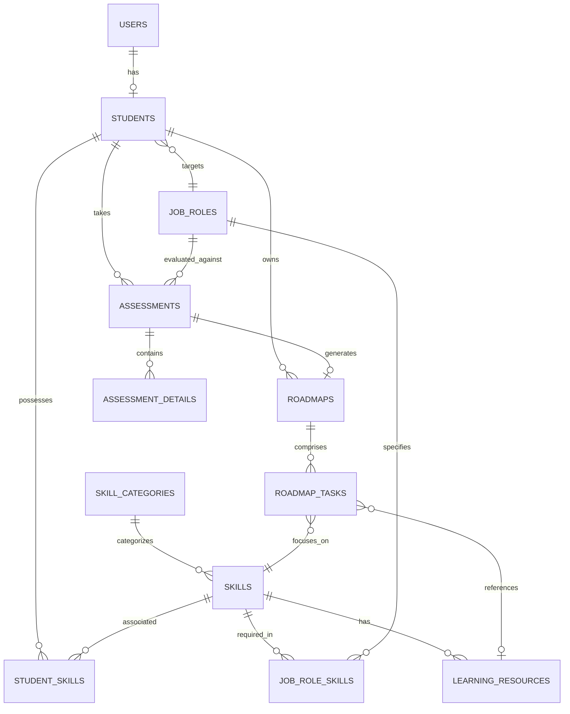

# Database Design: Skill-Gap Analyzer

## Overview
The **Skill-Gap Analyzer for Placement Readiness** uses MySQL 8.0 with InnoDB engine and UTF-8 charset. All relationships are mapped using Spring Data JPA / Hibernate.

---

## Entity Relationship Overview

---

## Table Schemas

### 1. `users`
Core user identity and authentication credentials.
- `id` (BIGINT, PK, AUTO_INCREMENT)
- `username` (VARCHAR(50), UNIQUE, NOT NULL)
- `email` (VARCHAR(100), UNIQUE, NOT NULL)
- `password_hash` (VARCHAR(255), NOT NULL) - BCrypt encrypted
- `role` (ENUM('ADMIN', 'STUDENT'), NOT NULL)
- `is_active` (BOOLEAN, DEFAULT true)
- `created_at` (TIMESTAMP, DEFAULT CURRENT_TIMESTAMP)

### 2. `students`
Student profile details linked 1-to-1 with a user record.
- `id` (BIGINT, PK, AUTO_INCREMENT)
- `user_id` (BIGINT, FK -> users.id, UNIQUE, NOT NULL)
- `full_name` (VARCHAR(100), NOT NULL)
- `phone` (VARCHAR(20))
- `college` (VARCHAR(150))
- `department` (VARCHAR(150))
- `academic_year` (VARCHAR(50))
- `graduation_year` (INT)
- `cgpa` (DECIMAL(3, 2))
- `resume_url` (VARCHAR(500))
- `preferred_job_role_id` (BIGINT, FK -> job_roles.id, NULL)
- `created_at` (TIMESTAMP, DEFAULT CURRENT_TIMESTAMP)

### 3. `skill_categories`
Taxonomy categories for grouping technical and soft skills.
- `id` (BIGINT, PK, AUTO_INCREMENT)
- `category_name` (VARCHAR(100), UNIQUE, NOT NULL)
- `description` (TEXT)
- `created_at` (TIMESTAMP, DEFAULT CURRENT_TIMESTAMP)

### 4. `skills`
Specific skills belonging to categories.
- `id` (BIGINT, PK, AUTO_INCREMENT)
- `skill_name` (VARCHAR(100), UNIQUE, NOT NULL)
- `category_id` (BIGINT, FK -> skill_categories.id, NOT NULL)
- `description` (TEXT)
- `created_at` (TIMESTAMP, DEFAULT CURRENT_TIMESTAMP)

### 5. `student_skills`
Skills added by students along with self-assessed proficiency.
- `id` (BIGINT, PK, AUTO_INCREMENT)
- `student_id` (BIGINT, FK -> students.id, NOT NULL)
- `skill_id` (BIGINT, FK -> skills.id, NOT NULL)
- `proficiency_level` (ENUM('BEGINNER', 'INTERMEDIATE', 'ADVANCED', 'EXPERT'), NOT NULL)
- `years_of_experience` (DECIMAL(3, 1))
- `last_practiced_date` (DATE)
- `created_at` (TIMESTAMP, DEFAULT CURRENT_TIMESTAMP)
- UNIQUE constraint on (`student_id`, `skill_id`)

### 6. `job_roles`
Industry placement roles available for benchmarking.
- `id` (BIGINT, PK, AUTO_INCREMENT)
- `role_name` (VARCHAR(100), UNIQUE, NOT NULL)
- `description` (TEXT)
- `created_at` (TIMESTAMP, DEFAULT CURRENT_TIMESTAMP)

### 7. `job_role_skills`
Required skills and target proficiencies for each job role.
- `id` (BIGINT, PK, AUTO_INCREMENT)
- `job_role_id` (BIGINT, FK -> job_roles.id, NOT NULL)
- `skill_id` (BIGINT, FK -> skills.id, NOT NULL)
- `required_proficiency` (ENUM('BEGINNER', 'INTERMEDIATE', 'ADVANCED', 'EXPERT'), NOT NULL)
- `importance_weight` (INT, 1 to 5, NOT NULL)
- `is_mandatory` (BOOLEAN, DEFAULT false)
- `created_at` (TIMESTAMP, DEFAULT CURRENT_TIMESTAMP)
- UNIQUE constraint on (`job_role_id`, `skill_id`)

### 8. `assessments`
Historical placement readiness assessment records.
- `id` (BIGINT, PK, AUTO_INCREMENT)
- `student_id` (BIGINT, FK -> students.id, NOT NULL)
- `job_role_id` (BIGINT, FK -> job_roles.id, NOT NULL)
- `readiness_score` (DECIMAL(5, 2), NOT NULL) - Weighted 0 to 100
- `total_required_skills` (INT, NOT NULL)
- `matched_skills` (INT, NOT NULL)
- `missing_skills_count` (INT, NOT NULL)
- `improvement_skills_count` (INT, NOT NULL)
- `assessment_date` (TIMESTAMP, DEFAULT CURRENT_TIMESTAMP)

### 9. `assessment_details`
Granular skill-by-skill evaluation results for each assessment.
- `id` (BIGINT, PK, AUTO_INCREMENT)
- `assessment_id` (BIGINT, FK -> assessments.id, NOT NULL)
- `skill_id` (BIGINT, FK -> skills.id, NOT NULL)
- `student_proficiency` (ENUM, NULL if missing)
- `required_proficiency` (ENUM, NOT NULL)
- `match_percentage` (DECIMAL(5, 2), NOT NULL)
- `importance_weight` (INT, NOT NULL)
- `gap_status` (ENUM('MATCHED', 'NEEDS_IMPROVEMENT', 'MISSING'), NOT NULL)

### 10. `learning_resources`
Curated educational materials linked to skills.
- `id` (BIGINT, PK, AUTO_INCREMENT)
- `skill_id` (BIGINT, FK -> skills.id, NOT NULL)
- `resource_title` (VARCHAR(200), NOT NULL)
- `resource_url` (VARCHAR(500), NOT NULL)
- `resource_type` (ENUM('VIDEO', 'ARTICLE', 'COURSE', 'BOOK', 'PRACTICE', 'DOCUMENTATION'), NOT NULL)
- `description` (TEXT)
- `created_at` (TIMESTAMP, DEFAULT CURRENT_TIMESTAMP)

### 11. `roadmaps`
Personalized improvement plans generated from assessments.
- `id` (BIGINT, PK, AUTO_INCREMENT)
- `student_id` (BIGINT, FK -> students.id, NOT NULL)
- `assessment_id` (BIGINT, FK -> assessments.id, NOT NULL)
- `roadmap_title` (VARCHAR(200), NOT NULL)
- `completion_percentage` (DECIMAL(5, 2), DEFAULT 0.0)
- `created_at` (TIMESTAMP, DEFAULT CURRENT_TIMESTAMP)

### 12. `roadmap_tasks`
Discrete milestone learning items with scheduled target dates.
- `id` (BIGINT, PK, AUTO_INCREMENT)
- `roadmap_id` (BIGINT, FK -> roadmaps.id, NOT NULL)
- `skill_id` (BIGINT, FK -> skills.id, NOT NULL)
- `task_title` (VARCHAR(200), NOT NULL)
- `task_description` (TEXT)
- `priority` (ENUM('HIGH', 'MEDIUM', 'LOW'), NOT NULL)
- `estimated_hours` (INT)
- `target_date` (DATE)
- `task_status` (ENUM('PENDING', 'IN_PROGRESS', 'COMPLETED'), DEFAULT 'PENDING')
- `resource_id` (BIGINT, FK -> learning_resources.id, NULL)
- `updated_at` (TIMESTAMP, DEFAULT CURRENT_TIMESTAMP ON UPDATE CURRENT_TIMESTAMP)
